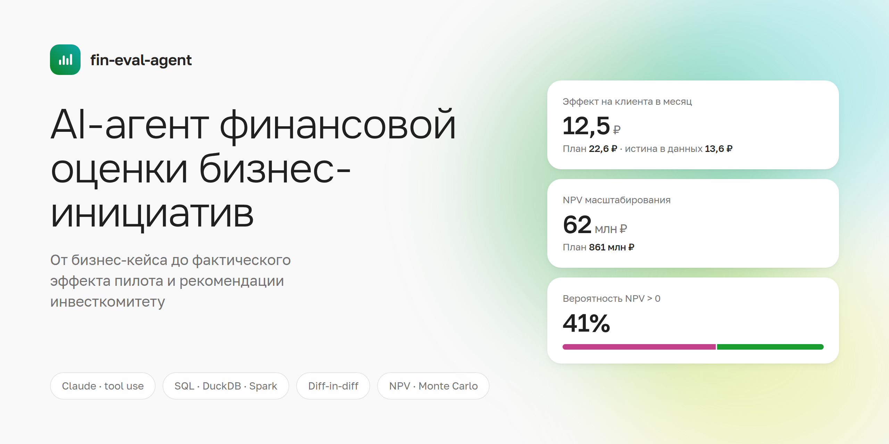
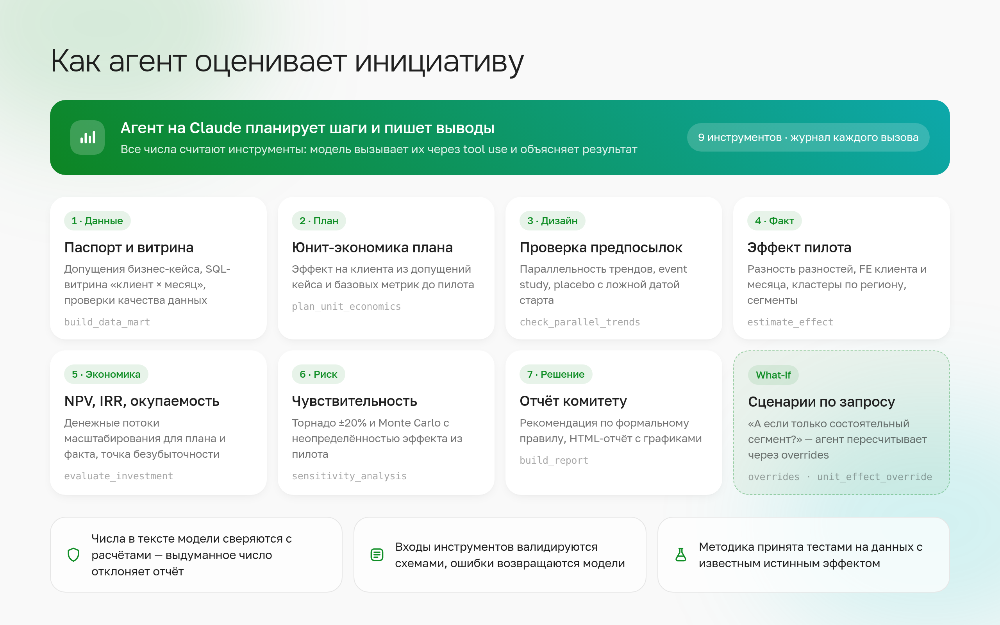
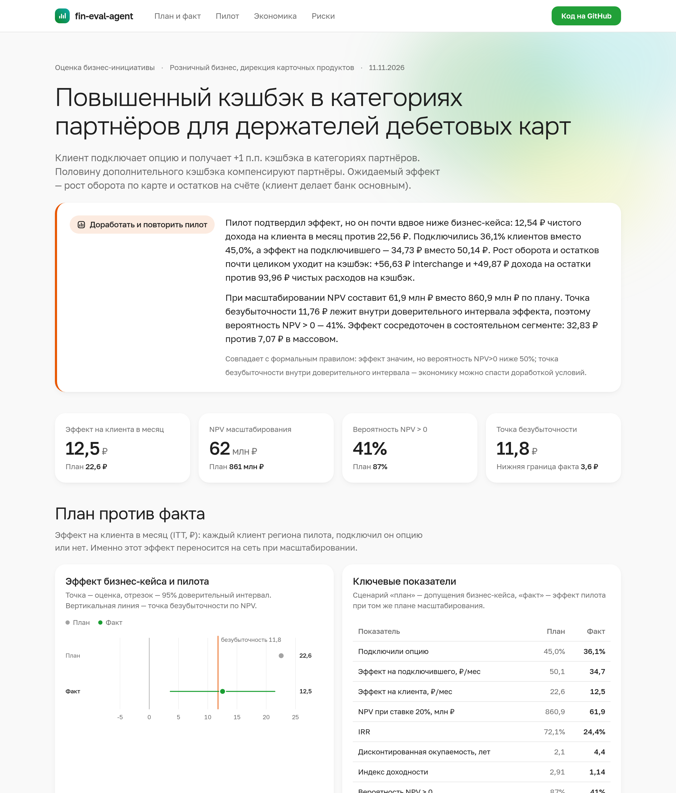

<p align="center"></p>

# fin-eval-agent

**AI-агент проходит полный цикл оценки бизнес-инициативы:** бизнес-кейс → данные пилота → фактический эффект → пересчёт экономики → рекомендация инвестиционному комитету.

Модель (Claude) планирует шаги и пишет выводы. Все числа считают детерминированные инструменты на SQL и Python. Каждое число в тексте модели сверяется с расчётами, прежде чем попасть в отчёт.

<p align="center"></p>

## Пример: повышенный кэшбэк в категориях партнёров

Бизнес-кейс обещал **+22,6 ₽** чистого дохода на клиента в месяц. Пилот шёл 24 месяца на 20 000 клиентов: 20 регионов пилота и 20 контрольных. Результат:

| | План | Факт |
|---|---:|---:|
| Подключили опцию | 45% | 36% |
| Эффект на клиента, ₽/мес | 22,6 | **12,5** (95% ДИ 3,6…21,5) |
| NPV масштабирования, млн ₽ | 861 | **62** |
| Вероятность NPV > 0 | 87% | **41%** |

- Эффект есть, но рост interchange и дохода на остатки почти целиком съедает кэшбэк.
- Точка безубыточности — 11,8 ₽ на клиента в месяц, то есть она внутри доверительного интервала.
- В состоятельном сегменте эффект в несколько раз выше, чем в массовом.

**Рекомендация агента:** доработать условия и повторить пилот.

<p align="center"></p>

Полный отчёт — интерактивная HTML-страница с графиками:
- [`runs/example/report.html`](runs/example/report.html): скачайте и откройте в браузере;
- Markdown-версия: [`report.md`](runs/example/report.md).

> **Данные синтетические, с известным истинным эффектом (13,6 ₽).** Поэтому методику можно проверить автотестом: оценка 12,5 ₽, и доверительный интервал накрывает истину. Наивное сравнение «подключившие против остальных» дало бы 373 ₽: самоотбор завышает эффект в разы.

## Запуск

```bash
python -m venv .venv && . .venv/bin/activate
pip install -r requirements.txt

python -m fineval.cli generate      # синтетические данные пилота → data/raw
python -m fineval.cli pipeline      # те же инструменты по фиксированному сценарию, без LLM
pytest -q                           # unit- и приёмочные тесты методики

export ANTHROPIC_API_KEY=...
python -m fineval.cli agent         # агент на Claude: отчёт (md + html) и журнал вызовов в runs/cashback_pilot/
python -m fineval.cli agent --task "Стоит ли масштабировать только на состоятельный сегмент?"
```

## Принципы

| | |
|---|---|
| **Модель не считает** | Расчёты живут в коде с тестами. Модель решает, что вызвать, и объясняет результат. |
| **Каждое число проверяемо** | `build_report` отклоняет текст с числом, которого нет в результатах инструментов. Модель получает список таких чисел и исправляет текст. |
| **Контракты вместо промптов** | Входы инструментов валидируются pydantic-схемами. Ошибку модель получает понятным текстом и исправляет вызов сама. |
| **Методику принимают по тестам** | Синтетика с известным эффектом проверяет три вещи: ДИ накрывает истину, тест трендов не даёт ложных тревог, нарушение предпосылок ловится. |
| **Решение по правилу** | Формальное правило (значимость, P(NPV>0), безубыточность) задано в методике. Отступить от него агент может только с обоснованием, и отчёт это показывает. |
| **Аудит** | Каждый вызов инструмента с входом, выходом и временем пишется в `trace.jsonl`. |

## Что внутри

| Путь | Что это |
|---|---|
| `initiatives/cashback_pilot.yaml` | паспорт инициативы: допущения кейса, масштаб, затраты, ставка, диапазоны неопределённости |
| `fineval/sql/mart_client_month.sql` | витрина «клиент × месяц», один SQL для DuckDB и Spark SQL |
| `spark/build_mart_spark.py` | та же витрина на PySpark для прод-объёмов |
| `fineval/tools/data.py` | сборка витрины, проверки качества данных, базовые метрики, плановая юнит-экономика |
| `fineval/tools/effect.py` | разность разностей с FE клиента и месяца, кластеры по региону, event study, placebo, ATT, сегменты |
| `fineval/tools/finance.py` | денежные потоки, NPV, IRR с проверкой единственности, окупаемость, безубыточность, торнадо, Monte Carlo |
| `fineval/tools/report.py` | отчёт: таблицы из расчётов, правило решения, проверка чисел в тексте модели |
| `fineval/tools/report_html.py` | HTML-отчёт: один файл, интерактивные графики, светлая и тёмная тема |
| `fineval/registry.py` | контракты инструментов: описание для модели, валидация, исправимые ошибки |
| `fineval/agent.py` | цикл агента на Claude API с журналом каждого вызова |
| `fineval/pipeline.py` | детерминированный прогон без LLM — для CI и воспроизводимости |
| `docs/METHODOLOGY.md` | методология оценки |
| `docs/TOOL_REQUIREMENTS.md` | пример бизнес-требований к tool-у для разработки и критерии приёмки |
| `tests/` | приёмка методики на данных с известным эффектом, unit-тесты финансов, тест цикла агента без сети |

---

<sub>Личный проект. Данные синтетические. Визуальное оформление — в духе открытой дизайн-системы SDDS (Plasma); фирменные знаки и шрифты банка не используются.</sub>
